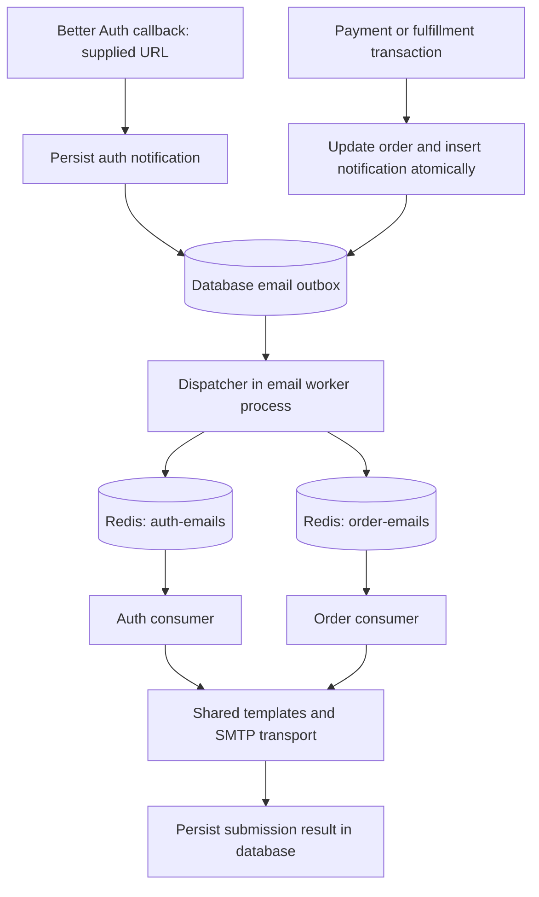

# Production email notifications

> **Status:** Proposed. **Date:** 2026-10-16. The application implementation and automated verification are complete (implementation commit `a16e984`). This status remains Proposed until manual staging and production-operations acceptance are recorded. No production deployment has occurred.

## Goal

### Delivered: bookstore email presentation

- Verification, password reset, payment receipt, acceptance, shipment, cancellation,
  and refund HTML messages share an email-compatible The Quiet Shelf layout: inline
  styles, presentation tables, a 600px maximum content width, the storefront
  cream/forest palette, serif headings, system-font body copy, hidden preheaders,
  prominent action buttons, and a consistent service-email footer.
- Authentication mail preserves the exact URL supplied by Better Auth, its one-hour
  expiry and security guidance, plain-text alternative, and existing subject. Its HTML
  includes a copyable fallback URL for clients where the button does not work.
- Order mail shows a stage-specific explanation, item quantity, unit price and line
  amount, subtotal, delivery and total, delivery address when recorded, and a readable
  UTC event time. Shipment uses tracking as its primary action when available and
  retains a View your order link; test-payment and refund-status language remains
  truthful.
- No API, queue, permission, persistence, migration, dependency, configuration, or
  trigger change is part of this presentation delivery. All seven kinds render HTML
  and plain text; untrusted values remain escaped, and account/tracking links retain
  their existing validation.

### Delivered: distinguish payment receipt and order acceptance

- Payment success sends **Payment received — awaiting order acceptance**. Keep the
  persisted `ORDER_CONFIRMED` kind as the payment-receipt event so existing encrypted
  payloads, dedupe keys, retries, and operator records remain compatible.
- `ORDER_ACCEPTED` is recorded on the first committed `SUBMITTED` → `PREPARING` transition,
  with **Order accepted — preparing your books** content in HTML and plain text.
  Record it in the existing transaction and `ORDER` queue; repeated confirmation
  must not send twice. Failed outbox insertion must roll back preparation/history.
- Preserve staff/admin authorization, verified-payment requirements, payment/order
  states, API shapes, configuration, cancellation/refund rules, and legacy-order
  suppression. No historical acceptance backfill. Both schemas use text kinds, so
  adding the TypeScript enum value requires no physical database migration.
- Payment records only the receipt; successful preparation records one acceptance;
  unpaid/rejected preparation records none; rollback remains atomic; and templates
  distinguish both stages. SQLite, PostgreSQL, and real Redis/SMTP verification pass.
- Deploy updated workers before enabling the API's new producer, so consumers know
  `ORDER_ACCEPTED`. Preserve payload encryption keys and stored kinds on rollback.

Deliver authentication and order emails through a durable database outbox, BullMQ,
and Redis, while preserving current authentication, order, payment, and storefront
contracts. Production quality applies to this email subsystem; live Stripe
payments and production launch of the entire store remain separate work.

## Scope

- Reuse Better Auth verification/password-reset URLs, existing token validation,
  verification enforcement, session revocation, rate limits, and auth templates.
- Add branded HTML and plain-text payment-receipt, acceptance, shipment, cancellation,
  and successful full-refund messages. No marketing, newsletters, attachments,
  delivery confirmation email, or public notification-management UI.
- Use one Redis deployment with separate `auth-emails` and `order-emails` queues.
  One independent Node.js worker process initially hosts both consumers and the
  outbox dispatcher. The HTTP API never sends SMTP in queued mode.
- Support SQLite development/tests and PostgreSQL production through existing
  DomainStore adapters. Preserve all existing records with additive migrations.
- Provide operations, health reporting, failure inspection, controlled replay,
  cleanup, real Redis integration tests, and captured-SMTP acceptance evidence.
- No GraphQL changes, generated API types, frontend implementation, or frontend
  branch are expected. Existing auth/order browser journeys must still pass.

## Delivered implementation and affected code

- [auth.ts](../../src/auth.ts) records `sendVerificationEmail` and
  `sendResetPassword` work through the queued outbox when queued delivery is selected.
  Verification and reset tokens expire after 3,600 seconds.
- [email.service.ts](../../src/modules/email/email.service.ts) owns the shared
  Nodemailer transport; [email.worker.ts](../../src/modules/email/email.worker.ts)
  owns dispatch, BullMQ consumers, and bounded shutdown.
- [payment.repository.ts](../../src/modules/payments/payment.repository.ts)
  reconciles provider state inside transactions, including recovery paths.
- [admin-order.repository.ts](../../src/modules/orders/admin-order.repository.ts)
  commits shipment/cancellation and their history inside transactions.
- [server.ts](../../src/server.ts) starts payment recovery and passes queued-email
  configuration to the API. For queued email delivery it opens neither SMTP nor Redis; the independently configured auth limiter and optional notification live transport may each use their own Redis connection. Existing
  payment recovery stays in place and only the separate email worker uses BullMQ.
- Extend [store.types.ts](../../src/database/store.types.ts), both physical
  schemas and store adapters, config, logger, app startup/readiness, and scripts.

## Architecture and responsibilities

The database is the authoritative notification ledger. Redis schedules execution;
an acknowledged enqueue is not evidence of SMTP submission or inbox delivery.
Dispatcher recovery considers all unfinished database records, including records
previously enqueued whose Redis job disappeared. Do not mark an email complete
when publishing its job. Queue payload is only `{ notificationId: string }`.

### Transaction boundaries

- Order notifications are inserted using the same `DomainStore` transaction as
  the actual state transition, through every webhook, recovery, and staff path.
  An outbox insertion failure rolls back that local transition. Never put Redis
  or SMTP calls inside a database transaction. Provider payment truth remains
  recoverable through existing payment event/reconciliation machinery.
- Auth callbacks await a short database persistence operation, never SMTP or
  Redis. Do not defer persistence to an untracked promise or configure a Better
  Auth background handler that returns before durable recording.
- Auth callback persistence is NOT atomic with Better Auth user/token writes.
  Installed Better Auth 1.7.7 verification awaits its callback; reset invokes
  `runInBackgroundOrAwait`, which can handle errors differently. Integration
  tests must pin signup, resend, reset, callback error, and database-failure
  behavior using the installed package before replacing the current dispatcher.
- If auth token/user persistence succeeds but outbox recording fails, do not
  fabricate success delivery evidence, delete accounts, or mark users verified.
  Record a redacted operational failure and allow existing resend/reset recovery.
  Keep unknown-account reset/resend public responses and timing protections;
  do not introduce account-dependent error responses. Framework callback errors
  must be normalized at the auth boundary if necessary. No claim of atomic auth
  issuance/delivery is made. Process failure before callback persistence requires
  the customer to request a new link; worker recovery cannot invent a lost URL.

## Message contracts and triggers

**Auth queue:** `VERIFY_EMAIL`, `RESET_PASSWORD`. Preserve supplied destination
email and exact framework URL; do not generate tokens in the worker. Extract
actual expiry from the framework token/verification record, not dispatch time;
never extend expiry. Do not start an auth SMTP attempt with less than 120 seconds
remaining. Skip jobs for deleted users, changed email addresses, already-verified
verification recipients, or known consumed/invalidated reset tokens. A resend is
a new logical notification, not deduplicated by user ID forever.

**Order queue:**

- `ORDER_CONFIRMED`: the payment-receipt event, sent on the first actual transition
  into PAID for a payment-required, non-cancelled order, including payment
  reconciliation. Its customer text is **Payment received — awaiting order
  acceptance**. Checkout creation, browser return alone, and legacy unpaid orders do
  not trigger it.
- `ORDER_ACCEPTED`: first committed `SUBMITTED` → `PREPARING` transition. Its
  customer text is **Order accepted — preparing your books**. A repeated preparation
  request is a no-op and does not create a second notification. An unpaid or rejected
  preparation creates none.
- `ORDER_SHIPPED`: first committed transition to SHIPPED. Include only recorded
  optional carrier/tracking data; no delivery guarantee or invented ETA.
- `ORDER_CANCELLED`: first committed cancellation of an order that was paid or
  has refund history. Do not email abandoned/unpaid expiry or legacy orders.
  Include the saved customer-visible reason. State whether refund is pending,
  already complete, or requires support; cancellation is not proof of refund.
- `ORDER_REFUNDED`: first transition to REFUNDED after provider-confirmed success.
  Pending, failed, and retried refund operations do not send a success message.
- If payment arrives after cancellation, suppress purchase confirmation and
  create a cancellation/refund-pending notification in that payment transaction
  if one was not already created. Later confirmed refund creates its own message.
- Persist event-time recipient, customer/order details, item titles, quantities,
  unit amounts, subtotal, delivery fee, total, currency, timestamp, and applicable
  address/tracking/reason snapshots. Recipient is the stored order account email,
  not an arbitrary API field or the delivery recipient's name. Do not expose
  staff identity, provider secrets, internal errors, or other customers' records.
- Links use configured trusted origins and `/account/orders/:id`; authorization
  remains on that existing route. Escape HTML and validate tracking URL schemes
  against current shipment rules. USD cent formatting stays consistent with the
  existing order contract. Test-mode orders must be labeled as test payments.
- Outbox order sequence is allocated under the order lock; submit notifications
  in committed per-order sequence. Wait for predecessors to reach a terminal
  state. Terminal failure/uncertainty unblocks later events; never silently drop
  a cancellation/refund because an earlier confirmation failed.

## Durable model and state machine

The delivered `emailNotifications` logical table exists in both schemas:

- `id`: UUID primary key; `dedupeKey`: unique opaque hash; `kind`: enum above;
  `queue`: `AUTH | ORDER`; `userId` and `orderId`: nullable identifiers.
- `replayOfId`: nullable original-notification UUID for audited manual replay;
  `sequence`: nullable per-order integer with unique `(orderId, sequence)`;
  `templateVersion`: integer; `payloadCiphertext`, `payloadIv`, `payloadTag`,
  `payloadKeyId`: nullable authenticated-encryption fields.
- `status`: `PENDING | ENQUEUED | SENDING | SUBMITTED | EXPIRED | SKIPPED |
FAILED | UNCERTAIN`; `createdAt`, `expiresAt`, `nextAttemptAt`, `enqueuedAt`,
  `submittedAt`, `terminalAt`, `leaseUntil`: nullable timestamps as appropriate.
- `leaseToken`: nullable UUID; `dispatchAttempts`, `sendAttempts`: integers;
  `lastErrorCode` and `providerMessageId`: nullable bounded values, never raw
  exceptions or SMTP responses. Hash/redact provider identifiers in logs.
- Index due/nonterminal work, active leases, terminal retention, and order
  predecessors. Store operations are provider-neutral; Postgres uses row locks/
  skip-locked claims and SQLite conditional updates/short write transactions.
  Lease-sensitive writes require the matching token, not just the record ID.
- Dedupe order notifications using `(orderId, kind)` for current one-way states.
  Auth dedupe includes kind, recipient, and supplied URL digest to distinguish
  new tokens while preventing repeated callbacks for the same token. Use a
  keyed digest; never store token/link text in dedupe keys or Redis job IDs.
- Terminal states never re-enter the send path automatically. Database send
  attempts survive Redis job deletion, re-enqueue, and process restarts.

### Dispatch and Redis recovery

- Poll every 1 second in batches of 50. Claim dispatch work with a 30-second
  lease and token. Use stable BullMQ `jobId = notification UUID` (no colon), a
  per-environment prefix, and identical queue names/prefix in all processes.
- Publish outside the transaction, then acknowledge ENQUEUED using the claim
  token; consumer claiming may race that acknowledgement, which must never
  overwrite SENDING or a terminal result. Retry failed publication with capped
  backoff (1 second doubling to 60 seconds); retain durable work during outages.
- Every 30 seconds reconcile due PENDING/ENQUEUED records against queue jobs.
  Missing jobs are recreated; active/waiting/delayed jobs are left alone.
  Completed/failed jobs with unfinished database records require deliberate
  retry/recreation after lease checks. Never blindly remove active jobs.
- Stable job IDs help while jobs exist, but database uniqueness and conditional
  claims remain authoritative after BullMQ removes completed/failed jobs.
- After a consumer leaves a row `PENDING` or `ENQUEUED` (for example, a ledger
  retry delay or blocked per-order predecessor), it moves that same BullMQ job to
  delayed state for the ledger's `nextAttemptAt`, with a one-second minimum, and
  throws BullMQ's delayed control error. The job therefore does not complete and
  force an otherwise-avoidable 30-second reconciliation wait for the next attempt.
- Retain completed Redis jobs for at most 24 hours and failed jobs for at most
  7 days, each also bounded to 10,000 records per queue. Queue cleanup never
  deletes the authoritative database ledger or resets its send budget.

### Sending, retries, and uncertainty

- Initial consumer concurrency: auth 2, order 2. Start with ONE email worker
  replica, limiting combined SMTP inflight calls to 4. Before scaling replicas,
  configure a shared provider-approved rate/concurrency budget across both queues;
  per-queue limits alone do not enforce the provider's aggregate account limit.
- Auth gets up to 4 send attempts and order up to 8, with ledger-owned exponential
  backoff starting at 5 seconds and bounded by expiry. Persist attempts before each
  SMTP invocation. BullMQ jobs deliberately use `attempts: 1`; the dispatcher
  re-enqueues ledger work, so discarded jobs cannot reset the database retry budget.
  Classify invalid recipient/configuration and permanent SMTP failures as terminal;
  retry clearly transient failures.
- SENDING uses a 60-second lease, longer than the existing bounded SMTP timeouts.
  Re-check lease ownership immediately before SMTP. Dispatcher never reclaims
  SENDING into an automatic new send. Worker loss or an ambiguous network outcome
  after sending may have started becomes UNCERTAIN after lease expiry.
- SMTP has no general exactly-once guarantee. A lost acknowledgement or a crash
  after SMTP acceptance but before database update may have delivered a message.
  Do not automatically resend UNCERTAIN notifications. Operator-reviewed replay
  explicitly acknowledges duplicate risk. SMTP Message-ID may aid diagnosis;
  it is not a provider idempotency guarantee.
- SUBMITTED means accepted by the SMTP server, not inbox-delivered. Bounce/
  complaint webhooks and provider-specific idempotency are a future extension.

## Security, retention, and configuration

- Encrypt the entire recipient/template payload at rest with AES-256-GCM using
  `EMAIL_PAYLOAD_KEYS` (JSON key-ID to base64 32-byte key mapping) and
  `EMAIL_PAYLOAD_ACTIVE_KEY_ID`. Generate fresh IVs; bind notification ID/kind/
  template version as authenticated context. API encrypts, worker decrypts;
  Redis receives only IDs. Keys come from a secret manager/environment, never Git.
- Rotation keeps every old key referenced by a nonterminal row until its payload is
  purged. The worker checks all such key IDs before startup and each dispatch tick;
  expiry/uncertain recovery runs first, so an expired auth link never holds the
  worker blocked on a retired key indefinitely.
  a missing key emits only a redacted `EMAIL_PAYLOAD_KEY_UNAVAILABLE` event, stops
  progress/readiness, and retains the ciphertext. A key disappearing during a send
  race returns that row to pending without consuming an SMTP attempt. Restore the
  key before resuming; never terminal-purge work merely because a key is missing.
- Purge auth ciphertext immediately on terminal status or deadline, whichever
  comes first; purge order ciphertext 7 days after terminal status. Retain
  redacted terminal metadata/dedupe tombstones for 90 days, then delete in bounded
  batches. Replaying provider events after tombstone deletion must still consult
  actual order transitions, not synthesize historical sends. Backups must follow
  the deployment's token/PII retention policy; row cleanup cannot erase backups.
- Environment: `EMAIL_DELIVERY_MODE=inline|queued` (inline development/test only;
  queued required in production), `EMAIL_ORDER_NOTIFICATIONS_ENABLED=false`
  (explicit rollout opt-in), `REDIS_URL`, `EMAIL_QUEUE_PREFIX`, the encryption
  keys above, stable `EMAIL_DEDUPE_KEY`, `EMAIL_AUTH_CONCURRENCY=2`,
  `EMAIL_ORDER_CONCURRENCY=2`, and `EMAIL_WORKER_HEALTH_PORT=4010`. Production
  also requires an explicit deployment-unique `EMAIL_QUEUE_PREFIX`.
  Validate bounded positive concurrency and fail startup for malformed enabled
  configuration. Do not silently fall back to inline SMTP in queued mode.
- API needs DB and encryption keys, not SMTP or Redis connections for queued email delivery; independently configured auth limiting or live notifications may require their own Redis connections. The worker needs
  DB, Redis, keys, trusted origins, and existing SMTP configuration. Split config
  validation by process role. Worker startup must not seed data or run migrations.
- Use BullMQ-compatible Redis, persistence (AOF), `maxmemory-policy=noeviction`,
  private networking, authentication/ACLs, and verified TLS in production. Pin
  tested BullMQ/Redis-client versions in bun.lock and a tested Redis image in
  local/CI infrastructure; verify compatibility rather than assuming latest.
- API readiness checks durable enqueue prerequisites (DB/schema/active key),
  not email-queue Redis availability. The composite API readiness probe additionally
  checks the independently configured auth limiter's Redis connection when that mode
  is enabled. Worker readiness includes schema, keys, queue connection,
  and dispatcher/consumer heartbeats. SMTP outage is degraded delivery with
  alerting/retries, not API downtime. SIGTERM stops polling, closes consumers
  within 30 seconds, then closes SMTP/Redis/DB; interrupted sends become UNCERTAIN.
- Worker-only probes listen on loopback `EMAIL_WORKER_HEALTH_PORT=4010`, exposing
  `/health` for process liveness and `/ready` for dependency/loop readiness as
  status codes and fixed redacted labels. Refresh loop heartbeats every 10
  seconds; readiness fails after 30 seconds without progress, a missing payload key,
  disconnected Redis, or either BullMQ worker paused/not running. Configure the
  deployment's probe within the same container/network namespace; never expose
  this listener publicly. These are new internal worker endpoints, not changes
  to the API's public HTTP/GraphQL contracts.

## Operations and rollout

- Delivered commands: `bun run email:worker` (development),
  `bun run email:worker:start` (built worker), `bun run email:inspect -- --id UUID`,
  `bun run email:replay -- --id UUID --apply --acknowledge-duplicate-risk`.
  Build first with `bun run build` before using the production worker or either
  operator command, which execute compiled `dist/` files rather than a development
  TypeScript runner. An invalid operator ID exits nonzero with a fixed redacted code.
- `bun run email:worker` runs `tsx` without watch mode, so manually restart it after
  changing email source. `bun run dev` watches the API process, but restart any
  separately running backend process to reload inline-auth email changes.
- Without `--apply`, replay is a redacted preview. Applying any eligible replay
  requires `--acknowledge-duplicate-risk`; no arbitrary
  recipient/link editing; expired auth jobs require the normal resend/reset flow.
  Reject replay of successful, pending, skipped, or expired records. Replay uses
  a new audited delivery attempt linked to the original, with a bounded new budget.
- A replay's dedupe identity includes its new attempt UUID; it does not collide
  with the original event's dedupe key. Replayed order mail takes a new sequence
  under the same order lock. The original remains terminal and auditable.
- Inspection/replay is server-side operator access, not a public endpoint or
  customer/Admin GraphQL permission. Never print payloads, URLs, tokens, addresses,
  SMTP credentials, or Redis connection strings. Audit operator action IDs and
  target notification IDs without introducing unrelated Activity enum changes.
- Emit redacted counters/structured events for queue kind/status, oldest pending
  age, send failures, uncertain outcomes, dispatch failures, and heartbeat age.
  An initial monitoring rule alerts on auth pending age >60 seconds, order pending
  age >5 minutes, any UNCERTAIN result, or worker heartbeat age >30 seconds.
  Document the metric/log sink and actual alert routing before production cutover.
- Back up DB; apply both reviewed provider migrations through existing commands;
  provision Redis; deploy and verify workers that support `ORDER_ACCEPTED`, then
  stop or drain every older worker before enabling the API producer with
  `EMAIL_ORDER_NOTIFICATIONS_ENABLED=true`;
  exercise verification/reset via queue; enable order notifications only after
  captured SMTP and staging inbox evidence. No historical email backfill.
- During rollout, stop/drain old inline API processes before enabling queued auth;
  do not run both send paths for one request. Redis outages retain DB work.
  Rollback disables new order production through `EMAIL_ORDER_NOTIFICATIONS_ENABLED`
  and retains compatible workers until every pending `ORDER_ACCEPTED` record drains.
  It retains tables/rows and does not treat a full worker downgrade as safe while that
  new kind remains. Do not roll back to inline auth while pending auth work can still
  send; reconcile it first.

## Acceptance criteria and outstanding gates

- [x] Same-transaction order/outbox writes roll back together on both databases.
- [x] All listed triggers, replay/no-op paths, late payment after cancellation,
      immutable snapshots, safe copy/links, and per-order sequencing are verified.
- [x] API performs no SMTP/Redis network calls for queued email delivery; independently configured auth limiting and live notifications retain their own connections. Existing auth,
      authorization, checkout, cart, and order contracts remain intact.
- [x] Existing verification and reset links work through real Redis + worker +
      captured SMTP; expiry, resend, unknown-account behavior, and callback database
      failures are tested on installed Better Auth and both database providers.
- [x] Duplicate callbacks/webhooks/jobs and concurrent consumers produce one
      normal submission; Redis loss, removed jobs, crashes, and ack races recover
      without losing durable work or resetting the retry budget.
- [x] Expired auth jobs are not sent; uncertain SMTP outcomes stop for review;
      no exactly-once or inbox-delivery guarantee is claimed.
- [x] Queue isolation, bounded retry/permanent failure handling, shutdown,
      encryption/rotation/purge, redaction, inspection/replay, and monitoring pass.
- [x] Additive migration preserves populated data; production readiness/config fail
      correctly in automated checks.
- [x] Payment receipt and acceptance are distinct: payment retains the persisted
      `ORDER_CONFIRMED` kind, while the first successful preparation writes exactly
      one `ORDER_ACCEPTED` record in the same transaction.
- [x] The renderer rejects an unsupported persisted notification kind before SMTP;
      workers must be upgraded before the API can produce a new kind.
- [ ] Stage sender/domain, real inbox delivery, TLS Redis, secrets, provider
      throughput, and alert routing before production enablement.
- [x] Browser verification: PostgreSQL passed 72/72; the original SQLite run had one
      appearance/guest-cart hard-navigation race, and its focused appearance rerun
      passed 2/2 without frontend changes.

Current change verification (2026-10-16): six focused tests were first observed
failing for the missing presentation behavior and then passed; the focused set passed
32 tests. The full suite passed 303 tests with 1 skipped across 53 files, and lint and
build passed. A real loopback Redis and captured-SMTP check sent 8 messages across 13
assertions, including one acceptance email despite repeated preparation; its harness
normalizes quoted-printable soft line breaks before assertions. Synthetic desktop
previews covered all seven messages; 375px reset and shipment previews had no
horizontal overflow. These checks did not test Gmail, Outlook, or a native mail client.

## Validation and unresolved deployment inputs

Use isolated databases, a real disposable Redis instance, and local captured SMTP;
never send test messages to production recipients. Extend `test/auth-email.test.ts`,
`test/email-service.test.ts`, migration/payment/delivery suites and
`scripts/test-postgresql.ts`. Add dedicated notification/queue integration tests
and a reproducible `test:email` command that fails if required infrastructure is
missing rather than silently skipping. Validate process restarts and Redis data
loss, not only mocked Queue methods. Run normal test/lint/build/PostgreSQL checks
and existing frontend SQLite/PostgreSQL auth/order browser journeys. Manual staging
checks cover authorized sender, SPF/DKIM/DMARC, inbox rendering, HTTPS links, actual
alert routing, and backup/restore. Those are production cutover gates, not evidence
already obtained by writing this spec.

Deployment owner must supply Redis hosting/TLS/credentials, SMTP provider and
account throughput limits, sender/domain/DNS access, secret-key storage, monitoring
destination, and final HTTPS origins. These block production cutover, not the
isolated implementation. No additional product-scope decision is currently required.

## References

- [BullMQ production guidance](https://docs.bullmq.io/guide/going-to-production)
- [BullMQ retries](https://docs.bullmq.io/guide/retrying-failing-jobs)
- [BullMQ idempotent jobs](https://docs.bullmq.io/patterns/idempotent-jobs)
- [Better Auth email/password](https://www.better-auth.com/docs/authentication/email-password)
- [Current auth email contract](../auth-email/SPEC.md),
  [delivery contract](../delivery/SPEC.md), and
  [payment contract](../stripe-checkout/SPEC.md).
